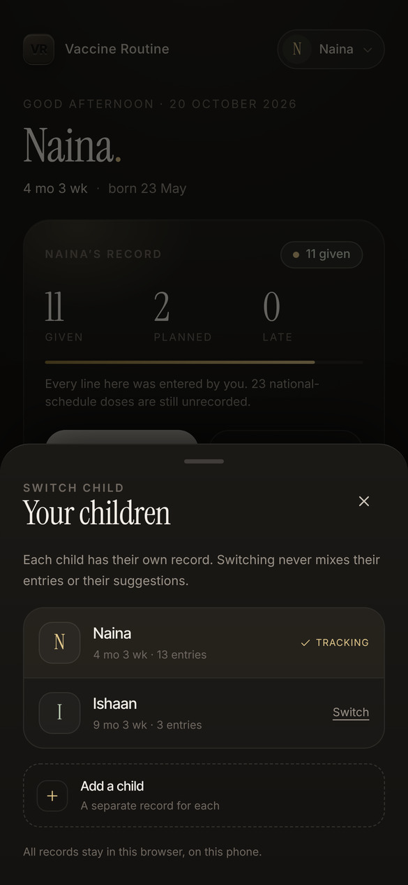
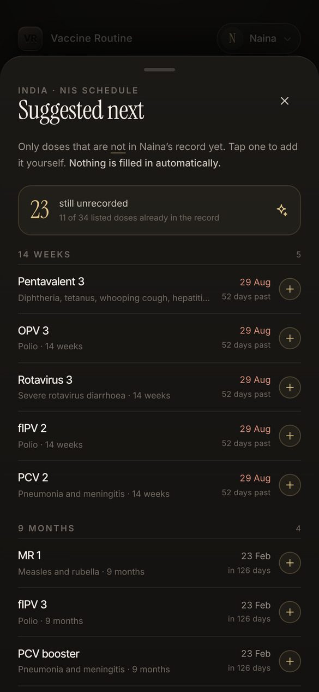
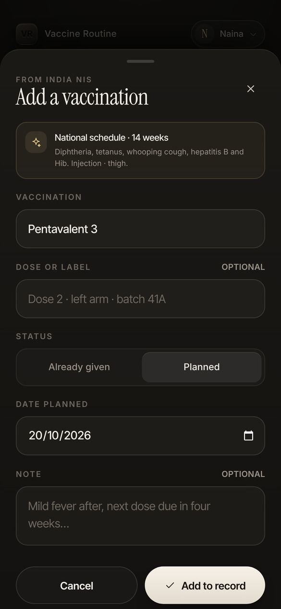

# Vaccine Routine

A calm, offline-first vaccine log and reminder for babies, built for India.
There is no pre-loaded schedule: every vaccination is entered by hand, with its
own name, date and note. India's **National Immunization Schedule** is there as a
suggestion, and only ever for doses the child's record does not already contain.

No accounts, no server, no analytics. Everything lives in this browser on this phone.


```
npm install
npm run dev      # http://localhost:5173
npm run build    # production build + service worker
npm run preview  # serve the production build
```

## Android app

A signed APK is attached to the
[latest release](https://github.com/owaiskhan-ash/vaccine-Tracker/releases/latest).
Download `Vaccine-Routine-1.0.apk`, open it on the phone, and allow installing
from this source once. It wraps the same build: no network, the same local
storage, and reminders handed to the phone's own scheduler so they arrive with
the app closed.

The shell lives in `android/` and is built by `.github/workflows/android.yml`.
The release key is committed with the project so that a later build installs
over an earlier one. It is a personal sideload key, not a Play Store key.


## What it does

**Today**: the record at a glance: how many entries are given, planned or late,
the next planned date, anything that has slipped past it, the last few entries,
and a compact **Suggested next** widget drawn from India's national schedule.

**Record**: every vaccination entered for the active child, grouped by month and
filterable by planned or given. Add, edit or delete from here.

**Suggestions**: the full national list, grouped by the age it is recommended
(birth to 16 years), with dates worked out from the child's date of birth. Doses
already in the record are not shown. Tapping one opens the entry sheet prefilled;
nothing is saved until the parent presses **Add to record**.

**Reminders**: a gentle nudge before and on each date the parent has planned, at
a time they choose, plus an `.ics` file for the phone's own calendar.

**You**: one profile per child, each with a separate record, an accent colour, a
readout of what is stored on the phone, and a way to erase it. Tap the child's
name at the top of **Today** to switch between children, or use the **Switch**
row in Settings.

| | | |
|---|---|---|
|  |  |  |





## Custom entries, not a fixed schedule

- The app opens with an empty record: no demo baby, no pre-filled doses, no
  sample data of any kind.
- Each entry is either **already given** (date, optional place) or **planned**
  (date). A name is free text; a datalist offers the national names for speed.
- If the typed name matches a national dose, the entry is linked to it, so that
  dose disappears from the suggestions. Renaming the entry away from the dose
  releases the link again.
- Suggestions match both linked entries and hand-typed ones ("Penta 2",
  "Hepatitis B birth dose"), so the parent is never asked about something they
  have already written down.
- Adding a child never copies another child's entries: records are kept per child.



## Offline, local, and careful with data

- State lives in `localStorage['vaccine-routine:state:v2']`, with a second slot
  (`:v2:backup`) holding the previous copy, written on every change.
- On first load an older install's `:v1` data is migrated: each stored per-dose
  record becomes a dated entry with its national name, and the old key is
  removed. Leftover demo children (`sample-…`) are dropped.
- An empty primary slot is respected. Deleting the last child is never undone by
  the spare copy on reload.
- Every child, name, date and note is validated on read and write; malformed
  entries are discarded rather than guessed at.
- **Erase all data** removes both slots and the reminder bookkeeping, then the
  app returns to onboarding, verified across a reload.
- No network calls at runtime. A service worker precaches the shell, fonts and
  icons on first load, so the app opens with no signal.
- `navigator.storage.persist()` is requested so the browser is less likely to
  evict the record under storage pressure.

## The national list

- Birth: BCG, OPV-0, hepatitis B birth dose. 6, 10 and 14 weeks: pentavalent,
  OPV, rotavirus, fIPV, PCV. 9 months: MR 1, fIPV 3, PCV booster, vitamin A.
  16–24 months: MR 2, DPT booster 1, OPV booster, vitamin A. Then vitamin A every
  six months to five years, DPT booster 2 at 5–6, and Td at 10 and 16: 34 doses
  across nine age groups.
- Includes the third fIPV dose added to the schedule in 2023 and the nationwide
  PCV rollout completed in 2021.
- These are **suggestions**, never a prescription. Timing differs between
  children and states; the health worker who sees the child decides.

## Design

Charcoal (`#0e0d0c`) surfaces, warm off-white type, a single muted accent per
child, Instrument Serif for headings and Inter Tight / Inter for everything else.
The icon is a debossed "VR" monogram on a charcoal rounded square, generated by
rendering `scripts/icon.html` and capturing the PNGs in `public/icons/`.

## Layout

```
src/
  data/schedule.ts      national catalogue, used only for suggestions
  lib/types.ts          child and entry model
  lib/engine.ts         ages, entry status, suggestion matching, reminder dates
  lib/storage.ts        v2 persistence, validation, v1 migration, spare copy
  lib/store.tsx         state and actions
  lib/reminders.ts      permission, scheduling, catch-up nudges
  lib/calendar.ts       .ics export with VALARMs
  components/           tab bar, sheets, entry rows, suggestion rows
  screens/              Today, Record, Reminders, Settings, Onboarding
  sw.ts                 precache service worker
```
