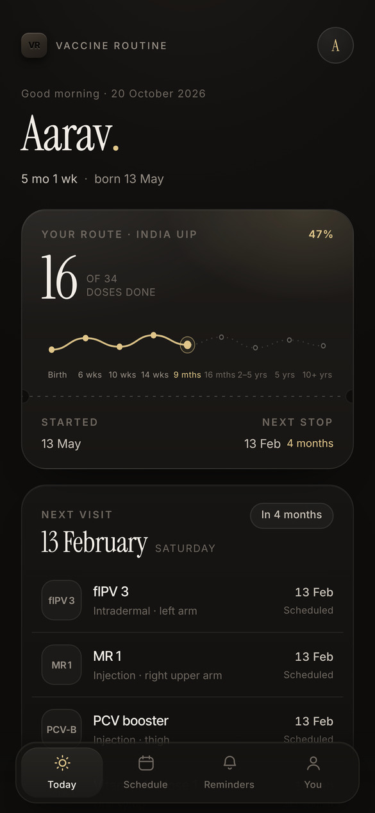
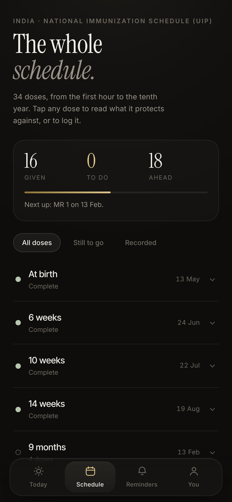
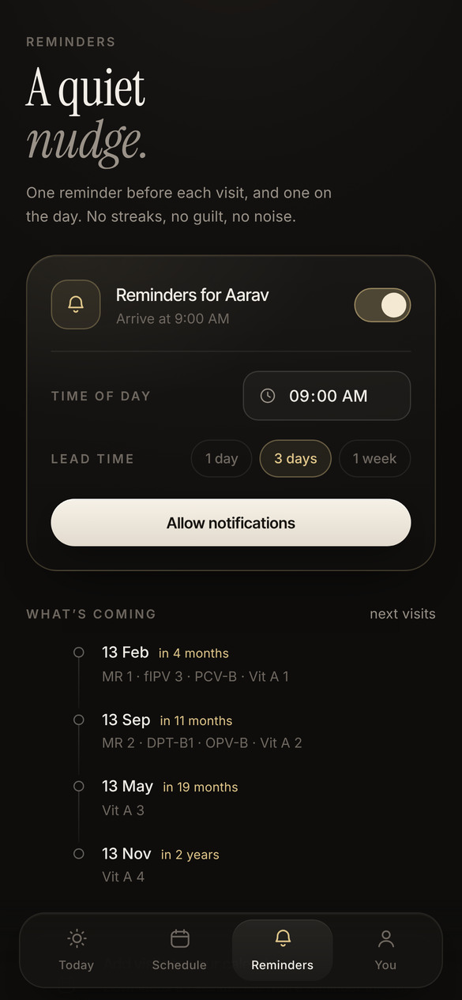
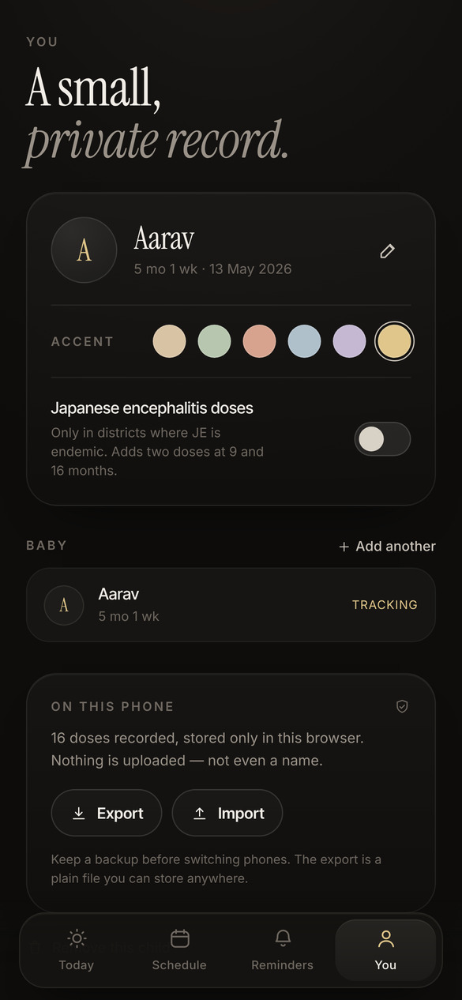

# Vaccine Routine

A calm, offline-first vaccine tracker and reminder for babies — built on India's
**National Immunization Schedule (UIP)**. No accounts, no server, no analytics.
Every name, date and dose lives in the browser on the phone.

```
npm install
npm run dev      # http://localhost:5173
npm run build    # production build + service worker
npm run preview  # serve the production build
```



## What it does

**Today** — one screen that answers "what now?". The baby's name and age, a
hand-drawn route across the nine visits (birth → 10+ years), how many doses are
done, the next visit with its doses, anything that has slipped past its window,
and the three doses coming after that.

**Schedule** — the complete national schedule, grouped by visit, with filters for
what is still to go and what has been recorded. Every dose explains what it
protects against, how it is given, and when its window closes.

**Reminders** — one nudge before each visit and one on the day, at a time you
choose. A calendar export (`.ics`) hands the visit dates to the phone's own
calendar so reminders fire even when the app is closed.

**You** — baby profile, accent colour, multiple children, optional JE doses,
JSON export/import backups, and the source of the schedule.

| | | |
|---|---|---|
|  |  |  |

## Offline & privacy

- A service worker precaches the app shell, fonts and icons on first load, so it
  opens with no signal — verified with the browser in offline mode.
- State is written to `localStorage` on every change, with a second backup copy so
  a corrupt write can't wipe a family's record.
- Nothing is ever uploaded. No network calls at runtime.
- `navigator.storage.persist()` is requested so the browser is less likely to
  evict the data under storage pressure.

## Schedule notes

- Built on the MoHFW National Immunization Schedule, including the third fIPV
  dose added on 1 January 2023 and the nationwide PCV rollout.
- Japanese encephalitis doses are hidden unless turned on, since JE is only given
  in endemic districts.
- Due dates are calculated from the date of birth with calendar-month maths
  (a baby born on the 31st gets a 28/29/30-day clamp rather than rolling over).
  A dose is called late only once its recommended window has closed, so a normal
  few days' delay is never framed as a failure.
- The app is a personal record, not medical advice.

## Design

Charcoal (`#0e0d0c`) surfaces, warm off-white type, a single muted accent per
child, Instrument Serif for headings and Inter Tight / Inter for everything else.
The icon is a debossed "VR" monogram on a charcoal rounded square — generated by
rendering `scripts/icon.html` and capturing the PNGs in `public/icons/`.

## Layout

```
src/
  data/schedule.ts      vaccine definitions + windows
  lib/engine.ts         due dates, status, progress, reminder plan
  lib/storage.ts        local persistence, backup copy, import/export
  lib/reminders.ts      permission, scheduling, catch-up nudges
  lib/calendar.ts       .ics export with VALARMs
  components/           tab bar, sheets, rows, route line
  screens/              Today, Schedule, Reminders, Settings, Onboarding
  sw.ts                 precache service worker
```
